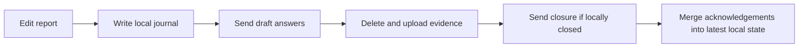

# Client architecture and persistence

The client is a Qt/C++ controller with a QML interface. A single `Lem` instance is exposed as the
`lem` context property. QML reads projections and invokes controller actions; mutating a JavaScript
copy is not a durable edit.

## Source map

| Source | Responsibility |
| --- | --- |
| [main.cpp](../app/src/main.cpp) | Application identity, storage setup, QML engine and isolated smoke-test entry point |
| [Lem.h](../app/src/Lem.h) | Public properties/actions, notifications and operation guards |
| [Lem.cpp](../app/src/Lem.cpp) | Catalogue/report navigation, answer editing, media admission, persistence and closure |
| [LemOffline.cpp](../app/src/LemOffline.cpp) | Journals, synchronization, acknowledgements, conflicts and independent copies |
| [LemReportGroups.cpp](../app/src/LemReportGroups.cpp) | Scoped QVE/measurement copying, signature drawing/photo import and multi-file evidence |
| [Main.qml](../app/qml/Main.qml) | Pages, controls, group tabs, review dialogs and evidence actions |
| [ReportPdf.cpp](../app/src/ReportPdf.cpp) | Native Qt painting bridge for the common PDF layout and local evidence |
| [Checklist.h](../app/src/Checklist.h), [Measurements.h](../app/src/Measurements.h) | Connector questions, editable-v6 corrections, measurement formatting and validation |
| [AppStorage.h](../app/src/AppStorage.h), [SafeStorage.h](../app/src/SafeStorage.h) | Storage migration, scoped paths and private-file safeguards |
| [NetworkSecurity.h](../app/src/NetworkSecurity.h), [EvidenceMedia.h](../app/src/EvidenceMedia.h) | Reply limits/redirects and bounded native evidence handling |
| [ServerSettings.h](../app/src/ServerSettings.h), [Theme.h](../app/src/Theme.h) | Server preference migration and appearance defaults |

## State and notifications

`m_reports` holds reports by UUID; `m_current` is the selected report mirrored back into that
collection after edits. `m_template` supplies the selected checklist. `m_catalogues` caches contract
catalogue summaries, while `m_user` and `m_token` describe the local account/session.

| Signal/state | Contract |
| --- | --- |
| `currentChanged`, `photosChanged` | Report and photo projections; answer edits must not recreate unchanged thumbnail delegates |
| `sectionsChanged`, `contractsChanged`, `chargersChanged` | Model-specific changes; catalogue progress alone should not refilter/rebuild the UI |
| `localSaveStateChanged` | Journal backlog/error state |
| `operationChanged` | Coalesced transfer/progress presentation |
| `changed` | General state reconciliation; avoid using it for every transfer byte |
| `saving`, `busy`, `syncing`, `refreshing` | Different operations with different edit/navigation guards |

`online()` checks for a token; it does not prove reachability. Background synchronization can
coexist with typing. Identity changes, cleanup, closure and group-copy operations have stricter
guards.

## Durable local state

`AppStorage::prepare()` selects the application data root. `last-user.json` stores reopening
identity/server data, not the bearer token. The server preference is stored in QSettings. The
account cache is scoped by a server-URL hash and user UUID.

| File | Purpose |
| --- | --- |
| `cache.json` | Full metadata checkpoint, reports, catalogues, selected contract and local tombstones |
| `edits/<report-id hash>.json` | Newer per-report journal snapshot |
| `photos/<evidence UUID>.<extension>` | Private image/video files; paths and acknowledgement metadata are kept in JSON |

`queueEdits()` coalesces input for 20 ms and writes an immutable snapshot through `QSaveFile`. A
completed write clears a pending entry only if it still matches the snapshot written. Newer typing
stays queued. `flushEdits()` is a blocking durability boundary; `persist()` checkpoints before
removing old journals. Startup replays newer eligible journals, excluding tombstones and mismatched
owners.

Starting a new intervention and saving correction dates use `checkpointReport()`.
It flushes ordinary journaled edits before atomically writing a cache with the proposed
report. The editor and sync queue see the proposed draft or dates only after commit.
On failure, the previous report state and its journals stay recoverable. The catalogue
offers another attempt at **Nova intervenção**, and the date dialog keeps the entered
values for retry. The ordinary `persist()` contract remains a success flag for callers
checkpointing their current state.

Cache and journal reads validate JSON and the essential report structure. An unreadable or incomplete
local store is a recovery condition: the client reports a local-save error and suspends report metadata writes,
synchronization and evidence cleanup. It preserves the original files rather than replacing them
with an empty account. It does not repair corrupt bytes automatically; restore/recover the affected
files and restart/reload before resuming work.

A successful UI edit is not the same as a completed disk write or server acknowledgement. Surface
`saving` and `localSaveError`; do not remove evidence after a failed save.

## Synchronization and acknowledgement merging

The queue is derived from report state, not a separate queue database. Important fields are `dirty`
, `revision`, `_edit_seq`, `_defer_photo_sync`, `deleted_photos`, `_inflight_payload`,
`_inflight_revision` and `_conflict`.

- `revision` is the last known server revision. `_edit_seq` tracks local mutation order; they are
  not interchangeable.
- Idle sending is normally scheduled after 8 seconds. Evidence is deferred until a group/report
  boundary, explicit synchronization or closure. A boundary schedules eligible work after 1.5
  seconds.
- Transient failure backs off from 30 seconds up to 600 seconds. A cached catalogue normally
  refreshes after 15 minutes.
- A locally closed report is uploaded as a draft until its evidence is reconciled; closure is sent
  last.
- Upload selection includes only reports owned by the logged-in user. Read-only copies are never
  uploaded. The server independently checks the current owner for answers, closure and evidence.
- Manual synchronization also refreshes the selected catalogue and the open report when it has no
  local edits. Catalogue summaries carry server revisions; a stale clean copy cannot mask a newer
  server status/owner. Opening another owner's clean cached report checks the server again.
- Dirty reports are retained for conflict handling rather than replaced by a background download.
- Before a PUT, a durable in-flight fingerprint allows recognition of an accepted request whose
  acknowledgement was lost.
- `mergeSync()` reads the latest local report and merges acknowledgement facts. An older response
  must not overwrite newer typing or clear a newer edit sequence.
- Evidence deletion is queued even when a local upload was not acknowledged: the server may already
  have accepted its bytes.

Capture report/evidence IDs before asynchronous work, then re-read the latest state when applying
results. Do not assume the page, account, selected report or answer value is unchanged.

## Conflicts, deletion and cache policy

401 clears the token while retaining local work. Permission/revision conflicts preserve protected
work for comparison or an independent copy. Validation failure keeps local data for correction. A
confirmed **410** is different: permanent server deletion removes the corresponding local report and
private evidence rather than reviving it.

Explicit refresh refuses to overwrite dirty local work. Opening cached metadata does not download
every original. Offline download pins a report and fetches missing files with four concurrent requests.
`requestPhoto()` streams to a private `QSaveFile`, retries transient failures at most three times,
and resumes evidence using `Range`/`If-Range` with its SHA-256 digest. A full 200 response safely
restarts the file for compatibility with older servers. Only validated, complete files are published.
Batch metadata is checkpointed every eight successes and at completion; startup reconciles atomic
files committed between checkpoints. Authentication/access failures stop the batch; other failed
items preserve the rest of the queue. Local evidence cleanup retains report metadata and only removes eligible synchronized
private files. Unsaved, unacknowledged, dirty or conflicted work remains protected. Automatic eviction also
requires a confirmed server revision and no pending evidence deletions.

`currentReportDownloadingPhotos` includes the selected report's bulk and individual evidence
requests. Report actions use this scope, while session changes and global cleanup retain the global
transfer guard. Download callbacks always retain their original report ID, so deleting a different
draft cannot redirect bytes or restore that draft. The QML menu and confirmation use the same scope.

HTTP 423 during sync marks all locally known reports in that contract with private
`_contract_unavailable` metadata. It does not clear dirty state, advance revisions or create an
ownership conflict. Checkpoints preserve the suspension across restart; the sync queue skips it
and processes other contracts. Only a successful active-contract refresh clears this marker after
restoration. The API independently enforces retention for reads, new/existing reports and evidence.
Manual synchronization requested during an active operation retains its receive/refresh intent
until the scheduler can run it; it must not degrade into an upload-only automatic attempt.

## Copying and signatures

An independent report backup remaps signature references to its new evidence IDs, preserving the
signer, timestamp and image bytes. An invalid/missing source signature reference blocks that backup
rather than marking an incomplete copy as safe for discarding the original.
This includes `legacy_signatures`: their old question keys can point to evidence migrated into
ANT, so validate the referenced PNG rather than requiring a current-question checkpoint match.
Independent copies remove the source UUID's `frozen_upload` transfer marker before migration.
Rejected historical closures also remove this marker when reopening locally; otherwise the guard
would leave the recovered draft permanently uneditable. The current-draft PUT migrates it atomically.
Sync skips an unchanged payload PUT only if the form version and historical-upload marker also
match. Identical answers must not leave a recovered draft stranded in the old server form.

A group copy stages fresh evidence IDs/files, verifies source metadata/digests and commits only
after all files are durable. Unrelated fields remain editable and are read from the latest target at
commit. One copy can wait behind the other group; that pending request is in memory and is not
recovered after closing the application.

Desktop `importSignature()` reads a local JPG/PNG, bounds input, prepares an image no larger than
700 × 700 and passes normalized PNG data to `saveSignature()`. The signature reference records the
signer and timestamp. Replacing it creates a fresh evidence ID; changing the signer invalidates the
old reference. Android uses drawn signatures in the current UI.

See the [shared report contract](../../Common/docs/report-contract.md) for exact field rules and
[Field workflow](field-workflow.md) for user actions.

## Shared PDF presentation

`ReportPdf.cpp` runs `shared/report/layout.js` through QJSEngine and supplies Qt drawing
primitives. The server's `pdf_worker.py` uses the same model, bundled fonts and artwork.
New Qt or font versions must pass the cross-renderer checks in the test guide.
`withContractPresentation()` overlays only live contract presentation on cached report
metadata. Refresh/load reconciles that field independently of dirty flags, edit sequence,
owner, answers and report revision. Export applies the newest received presentation;
old snapshots still default to Lem when no presentation is available.

`ReportBundle.h` streams a standard stored ZIP with CRC32, UTF-8 names and data descriptors.
Closed reports with all originals use local PDF/ZIP generation on the worker pool, including offline
pending work. The ZIP includes sanitized public JSON and hashes originals while writing; it excludes
local paths and synchronization internals. Desktop output is atomic. Android stages the archive
before copying to the selected content URI. Missing local evidence selects the existing server
fallback for synchronized reports. Network PDF/ZIP output is staged on disk and copied in bounded
blocks, avoiding a report-sized response buffer; regenerated archives restart on retry.

Administrator correction starts with a server-cloned draft and preserves the source until the
commit acknowledgement. `correction` records source/editor/state; ordinary edit controls apply
only to the editor on compiled Windows/Linux desktop targets. Final sync uses the replacement
endpoint, then restores the original technician owner. Lost acknowledgements are recovered before
ordinary owner mismatch handling. Replacement tombstones preserve dirty local copies as conflicts;
independent draft copies strip correction metadata. A failed local checkpoint keeps the editor
eligible to retry, rather than stranding a dirty report under another owner. Local copies of cloned
evidence use independent files; deleting the source cannot invalidate replacement paths.
