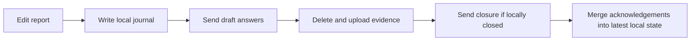

# Client architecture and persistence

The client is a Qt/C++ controller with a QML interface. A single `Lem` instance is exposed as the
`lem` context property. QML reads projections and invokes controller actions; mutating a JavaScript
copy is not a durable edit.

## Source map

| Source | Responsibility |
| --- | --- |
| [main.cpp](../app/src/main.cpp) | Application identity, storage setup, QML engine and isolated smoke-test entry point |
| [Lem.h](../app/src/Lem.h) | Public properties/actions, notifications and operation guards |
| [Lem.cpp](../app/src/Lem.cpp) | Catalogue/report navigation, answer editing, media admission, persistence and closure |
| [LemOffline.cpp](../app/src/LemOffline.cpp) | Journals, synchronization, acknowledgements, conflicts and independent copies |
| [LemReportGroups.cpp](../app/src/LemReportGroups.cpp) | Scoped QVE/measurement copying, signature drawing/photo import and multi-file evidence |
| [Main.qml](../app/qml/Main.qml) | Pages, controls, group tabs, review dialogs and evidence actions |
| [ReportPdf.cpp](../app/src/ReportPdf.cpp) | Local PDF rendering from a report snapshot and available local evidence |
| [Checklist.h](../app/src/Checklist.h), [Measurements.h](../app/src/Measurements.h) | Connector questions, editable-v6 corrections, measurement formatting and validation |
| [AppStorage.h](../app/src/AppStorage.h), [SafeStorage.h](../app/src/SafeStorage.h) | Storage migration, scoped paths and private-file safeguards |
| [NetworkSecurity.h](../app/src/NetworkSecurity.h), [EvidenceMedia.h](../app/src/EvidenceMedia.h) | Reply limits/redirects and bounded native evidence handling |
| [ServerSettings.h](../app/src/ServerSettings.h), [Theme.h](../app/src/Theme.h) | Server preference migration and appearance defaults |

## State and notifications

`m_reports` holds reports by UUID; `m_current` is the selected report mirrored back into that
collection after edits. `m_template` supplies the selected checklist. `m_catalogues` caches contract
catalogue summaries, while `m_user` and `m_token` describe the local account/session.

| Signal/state | Contract |
| --- | --- |
| `currentChanged`, `photosChanged` | Report and photo projections; answer edits must not recreate unchanged thumbnail delegates |
| `sectionsChanged`, `contractsChanged`, `chargersChanged` | Model-specific changes; catalogue progress alone should not refilter/rebuild the UI |
| `localSaveStateChanged` | Journal backlog/error state |
| `operationChanged` | Coalesced transfer/progress presentation |
| `changed` | General state reconciliation; avoid using it for every transfer byte |
| `saving`, `busy`, `syncing`, `refreshing` | Different operations with different edit/navigation guards |

`online()` checks for a token; it does not prove reachability. Background synchronization can
coexist with typing. Identity changes, cleanup, closure and group-copy operations have stricter
guards.

## Durable local state

`AppStorage::prepare()` selects the application data root. `last-user.json` stores reopening
identity/server data, not the bearer token. The server preference is stored in QSettings. The
account cache is scoped by a server-URL hash and user UUID.

| File | Purpose |
| --- | --- |
| `cache.json` | Full metadata checkpoint, reports, catalogues, selected contract and local tombstones |
| `edits/<report-id hash>.json` | Newer per-report journal snapshot |
| `photos/<evidence UUID>.<extension>` | Private image/video files; paths and acknowledgement metadata are kept in JSON |

`queueEdits()` coalesces input for 20 ms and writes an immutable snapshot through `QSaveFile`. A
completed write clears a pending entry only if it still matches the snapshot written. Newer typing
stays queued. `flushEdits()` is a blocking durability boundary; `persist()` checkpoints before
removing old journals. Startup replays newer eligible journals, excluding tombstones and mismatched
owners.

A successful UI edit is not the same as a completed disk write or server acknowledgement. Surface
`saving` and `localSaveError`; do not remove evidence after a failed save.

## Synchronization and acknowledgement merging

The queue is derived from report state, not a separate queue database. Important fields are `dirty`
, `revision`, `_edit_seq`, `_defer_photo_sync`, `deleted_photos`, `_inflight_payload`,
`_inflight_revision` and `_conflict`.

- `revision` is the last known server revision. `_edit_seq` tracks local mutation order; they are
  not interchangeable.
- Idle sending is normally scheduled after 8 seconds. Evidence is deferred until a group/report
  boundary, explicit synchronization or closure. A boundary schedules eligible work after 1.5
  seconds.
- Transient failure backs off from 30 seconds up to 600 seconds. A cached catalogue normally
  refreshes after 15 minutes.
- A locally closed report is uploaded as a draft until its evidence is reconciled; closure is sent
  last.
- Before a PUT, a durable in-flight fingerprint allows recognition of an accepted request whose
  acknowledgement was lost.
- `mergeSync()` reads the latest local report and merges acknowledgement facts. An older response
  must not overwrite newer typing or clear a newer edit sequence.
- Evidence deletion is queued even when a local upload was not acknowledged: the server may already
  have accepted its bytes.

Capture report/evidence IDs before asynchronous work, then re-read the latest state when applying
results. Do not assume the page, account, selected report or answer value is unchanged.

## Conflicts, deletion and cache policy

401 clears the token while retaining local work. Permission/revision conflicts preserve protected
work for comparison or an independent copy. Validation failure keeps local data for correction. A
confirmed **410** is different: permanent server deletion removes the corresponding local report and
private evidence rather than reviving it.

Explicit refresh refuses to overwrite dirty local work. Opening cached metadata does not download
every original. Offline download pins a report and fetches missing files; the download pump bounds
concurrency. Local evidence cleanup retains report metadata and only removes eligible synchronized
private files. Unsaved, unacknowledged, dirty or conflicted work remains protected.

## Copying and signatures

A group copy stages fresh evidence IDs/files, verifies source metadata/digests and commits only
after all files are durable. Unrelated fields remain editable and are read from the latest target at
commit. One copy can wait behind the other group; that pending request is in memory and is not
recovered after closing the application.

Desktop `importSignature()` reads a local JPG/PNG, bounds input, prepares an image no larger than
700 × 700 and passes normalized PNG data to `saveSignature()`. The signature reference records the
signer and timestamp. Replacing it creates a fresh evidence ID; changing the signer invalidates the
old reference. Android uses drawn signatures in the current UI.

See the [shared report contract](../../Common/docs/report-contract.md) for exact field rules and
[Field workflow](field-workflow.md) for user actions.
