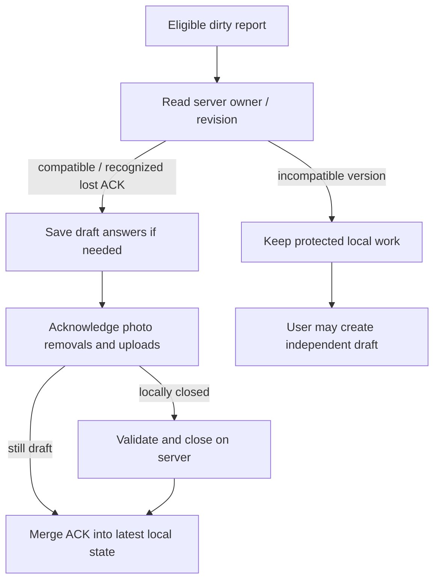

# Offline synchronization and photographs

The synchronization queue is derived from local report JSON, not an independent
queue database. `dirty`, the local edit sequence, server revision, photo metadata
and durable in-flight/conflict fields jointly describe outstanding work.

## When network work happens

| Trigger | Current policy |
| --- | --- |
| Answer/observation change | Queue local journal immediately; normal idle send is scheduled after 8 seconds. |
| Attach photograph | Copy/journal locally and set `_defer_photo_sync`; automatic sending waits for a boundary. |
| Change question group / leave report | Release that hold and schedule send after 1.5 seconds. |
| Manual synchronization | Release photograph holds for all local reports; durable conflicts remain protected. |
| Close report | Validate/close locally, release the hold and request sending when authenticated. |
| Login / foreground / connectivity return | Schedule eligible outstanding work; do not assume every request will succeed. |
| Transient request error | Retry from 30 seconds, doubling to a 600-second maximum; respect `m_retryNotBefore`. |
| Select contract | Display cached data first; catalogue refresh normally uses a 15-minute age threshold. |
| Open cached report | No automatic image download; explicit report refresh refuses dirty local work. |
| Download all photographs | Pin report for offline use, queue missing originals, reuse local files. |

The constants above describe the current implementation, not an external policy.
See `scheduleSync`, `startSync`, `releasePhotoSync`, `refreshCatalogue` and the
application-state connections in the constructor.

## Upload ordering

`syncNext(ids, index)` takes a value snapshot of one queued report. Revision-zero
reports use `/exists` to distinguish genuinely new work from a creation whose
response was lost. Existing reports must still refer to the same charger and owner.

Before a PUT, the client checkpoints `_inflight_payload` and the expected resulting
`_inflight_revision`. If the server accepted that PUT but its response never arrived,
a later GET can recognize the exact accepted version. It does not treat every newer
revision as compatible: unrelated revisions protect the local report as a conflict.

A locally closed report is sent as a draft while images are reconciled. In
`syncPhotos()`, queued image deletions run first, then missing uploads, then the
closed PUT. This gives the server the evidence required to validate completion.
Photo upload is sequential within an upload batch; the two-request limit described
below applies to downloads, not a promise of parallel uploading.

## Acknowledgements must not replace newer typing

While an HTTP request is in flight, the technician can continue editing. Its
captured `r` or `local` is therefore a **sent snapshot**, not the current report.
`mergeSync()` reads the latest collection entry and merges only acknowledgement
facts: revision/context fields, acknowledged upload IDs/digests and deleted IDs.

For example, a PUT sends edit sequence 12; the technician enters a note at sequence
13 before its response arrives. The response may advance the known revision, but
must not overwrite that note or mark sequence 13 clean. `dirty` clears only when the
latest edit sequence equals the sent one, every retained photo is acknowledged,
and no queued deletion remains.

The same rule applies when a photograph is removed during an older upload. Queue
its deletion even if its local `uploaded` flag is false: the server may already have
accepted its bytes while the acknowledgement was in transit.

## Error handling and explicit deletion

| Result | Client treatment |
| --- | --- |
| 401 | Clear session token; preserve local work and request login. |
| 403 / 409 | Mark a durable `_conflict`, keep local responses/files, exclude automatic resend. |
| 422 | Keep local work; mark attention in the session exclusion set. Manual send can retry after correction. |
| Other/transport failure | Preserve unsent work and schedule backoff. |
| 410 | Server confirms permanent report deletion: remove the local copy and its private images. |

The **410 case is an intentional exception** to conflict preservation. The current
implementation treats an explicit administrator/server deletion as authoritative;
it does not preserve that report as an ownership-conflict archive. Catalogue
refresh also consumes permanent deletion markers. Do not describe this behavior as
“every possible offline change is retained indefinitely.”

## Ownership/revision conflict recovery

`viewServerReport()` stores a separate `_conflict_remote` response. The QML dialog
shows its answers/notes, owner, state, revision and photo count. It does not replace
local payload or photo queues.

`copyLocalReport()` requires every source-local photo to have readable local bytes.
Missing uploaded images must first be downloaded; missing never-uploaded files
cannot be recovered from the server. Failure creates no partial report.

For a complete source, the method creates a fresh report UUID and a fresh UUID/file
for every image. It copies answers/notes, assigns the logged-in user, resets revision
to zero and status to draft, creates new start dates, removes completion/transient
sync/deletion fields and records `payload.source_report_id`. Even a locally closed
source produces a draft. The file worker copies bytes; only its completion callback
updates controller state and commits the full cache. A failed commit rolls memory
back and removes newly copied files.

The original records the backup ID and its edit sequence. `useServerReport()` can
open fresh server data over that local view only while the independent backup
exists, has not been edited and still has all image files, and the original edit
sequence has not changed. Otherwise another complete copy is required. The server
is fetched again rather than using an older comparison response.

## Download and storage policy

`getPhotos()` installs **metadata** despite its historical name. Existing private
files are reused; other image paths stay empty. `fetchPhotoForReport()` captures
report/photo IDs, validates maximum bytes and the advertised SHA-256 digest, writes
through `QSaveFile`, and reconciles into that report even if the UI navigated away.

Individual and complete-report downloads share `m_downloads` and at most two
simultaneous requests. Cancelling a batch stops remaining queued work; active
requests finish and keep useful results. A later request resumes only missing items.

Automatic cleanup considers images from synced, clean, closed reports that are not
current or pinned. It evicts oldest eligible originals when older than 7 days or
above the 256 MiB cache budget. This is not a hard total-storage cap: drafts,
protected conflicts, unsent images and explicit pins can exceed it.

Manual **clear local copies** is different: it removes eligible synced closed
report copies even if pinned/current, plus private files no longer referenced by
protected reports. Drafts and pending uploads remain. Neither cleanup mode deletes
server records or gallery originals. Copying a report intentionally duplicates image
files so later deletion of one report cannot invalidate the other.
